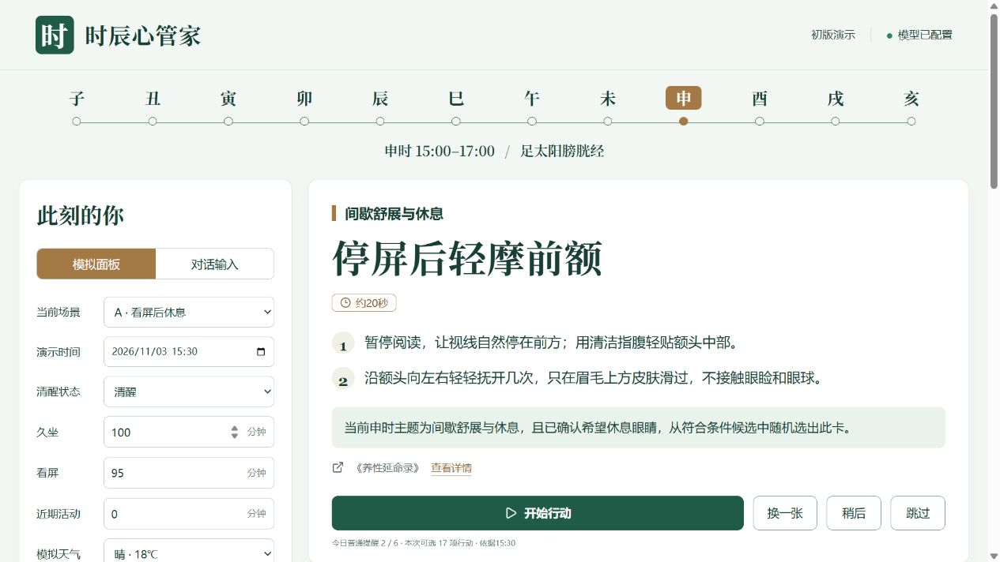

# 时辰心管家 · Shichen Wellness

面向健康成年人的日常行动 Demo：用时辰与节气组织内容，根据明确的生活情境筛选候选，随机选出一张可以开始的小行动，并展示出处和选择理由。

[在线演示](https://shichen-wellness.pages.dev/) · [GitHub 源码](https://github.com/liqingyang99999-create/shichen-wellness)

[参赛交付包（PPT＋视频＋提交说明）](https://github.com/liqingyang99999-create/shichen-wellness/releases/tag/v1.1.0) · [PPT下载](https://github.com/liqingyang99999-create/shichen-wellness/releases/download/v1.1.0/presentation.pptx) · [演示视频下载](https://github.com/liqingyang99999-create/shichen-wellness/releases/download/v1.1.0/demo-video.mp4)

访问验证（2026-11-04）：Cloudflare Pages 首页、状态接口和 OpenAPI 均返回 200；同域 Bearer API 返回 `providerMode:live`，查询与解释节点均实际成功。Pages 通过内部 Service Binding 调用同账号 Worker，手机无需另行连接 `workers.dev`。目标用户已在手机确认可以打开并生成卡片；其他网络的可达性以实际测试为准。

项目是独立的 React + Vite 网页、Cloudflare Pages 入口与 Worker API。模型负责理解描述、组织查询和解释；程序负责条件、频次、随机选择和输出校验，动作来自固定内容库。它不训练模型，不诊断疾病，不预测血压风险，也不把随机选卡称为“最佳疗效”。

## 体验与内容

- **手机日常入口**：[直接打开日常模式](https://shichen-wellness.pages.dev/?mode=daily)。使用真实时间和按需联网天气，设备睡眠、步数、全机应用用时未接入时明确显示未获取；主动查看不计提醒额度。
- **模拟面板**：六种可重置场景，展示普通提醒、夜间状态、节气卡及稍后流程。
- **独立对话**：默认当前真实北京时间，也可指定时间；先核对识别结果，再生成。不会继承模拟面板的情境或历史。
- **可解释工作流**：展开 11 个节点查看模型、检索、规则和选择记录。模型未配置或输出不合格时，明确显示离线或模板回退。
- **天气与地点**：支持手选城市、按需定位和本地家／公司条件预设；不接入穿戴设备。
- **136 项行动 + 24 节气**：64 项传统动作或传统主题启发、72 项现代日常内容，58 条来源。传统主题启发的步骤注明为现代整理。
- **智能体 API**：提供 OpenAPI 发现和 Bearer 鉴权的只读行动卡预览。



当前截图来自桌面浏览器。网页采用响应式布局；尚未完成 Android 真机验收，也未实现原生 App、后台提醒或锁屏通知。

安卓日常模式接入真实使用记录、步数与睡眠是后续计划，当前尚未实现；无权限或无数据时将保留未知状态。适用条件、权限和数据边界见 [安卓接入路线](docs/android-roadmap.md)。

## 本机运行

需要 Node.js **22.13.0 或更新版本**。在仓库根目录执行：

```sh
npm ci
npm run dev
```

打开终端显示的地址，默认 `http://127.0.0.1:5174`。保持服务运行，按 `Ctrl+C` 停止。首次启动不需要模型密钥：内容检索仍真实执行，模型部分使用明确标记的规则与模板。

要启用真实模型，在没有现有配置时，将 `.dev.vars.example` 复制为 `.dev.vars`，在本机编辑器中填写自己的 `LLM_API_KEY`，随后重启服务。不要提交该文件。服务端适配 OpenAI 兼容的聊天完成接口，当前默认 DeepSeek 配置见 `wrangler.jsonc`；更换服务后需验证 JSON 输出与参数兼容性。

```sh
npm run check
npm test
npm run build
npm run preview
```

`check` 检查 TypeScript，`test` 执行本地自动化测试，`build` 生成前端和 Worker 产物，`preview` 在本机预览构建结果（默认端口 4174）。测试中的模型响应和 GPS 位置是模拟输入，不证明线上模型或真实设备运行成功。完整覆盖测试会遍历 655,360 组条件，报告生成于 `test/reports/coverage.json`。

## 调用智能体 API

读取 `GET /api/agent/openapi.json` 可发现接口和函数工具描述。`POST /api/agent/card` 使用服务器单独配置的 `AGENT_API_KEY`；不能把模型供应商密钥作为智能体访问凭据。

```http
POST /api/agent/card
Authorization: Bearer <独立智能体访问密钥>
User-Agent: ShichenWellnessAgentClient/1.0
Content-Type: application/json
```

```json
{
  "snapshot": {
    "intent": "quiet",
    "mealPhase": "after",
    "atMeal": false
  }
}
```

这表示调用方已确认“餐后，希望安静休息”。省略 `now` 使用当前北京时间；可增加 `"now":"2026-11-04T12:03:00+08:00"` 演示指定时刻。未知条件省略，不根据“午饭”推断钟点、坐姿或闭目条件。

接口只做 `preview`，不计提醒次数、不保存会话、不接收任意模型地址或内容库。响应包含固定动作、解释、出处和节点摘要；以 `providerMode` 区分 `live`、`mixed`、`fallback` 与 `offline`，不能把 HTTP 200 等同于真实模型成功。

详见 [API 文档](docs/agent-api.md) 和 [Node.js 客户端](examples/agent-client.mjs)。调用方在私密环境中设置服务地址和访问密钥，密钥不进入工具参数或提示词。

## 部署到自己的 Cloudflare

```sh
npm run cf:login
npm run deploy
```

登录需要在本机浏览器完成 Cloudflare 授权。`deploy` 会构建并部署到当前账号；公开地址以 Wrangler 成功输出为准，不需要另建手机安装包。服务器密钥通过 Secret 配置，操作顺序和部署后验证见 [部署说明](docs/deployment.md)。

三个模型入口共享 `DEMO_RATE_LIMITER`：每个 Cloudflare 节点约 30 个请求／60 秒，缺绑定时拒绝模型请求。它是演示级流量控制，不是全局严格额度或费用上限；一次工作流可包含多次模型调用。

## 代码结构

```text
src/                    React 界面与浏览器交互
worker/index.ts         静态资源、API 分发及模型入口限流
server/engine.mjs       检索、条件过滤、抽卡与 11 节点轨迹
server/model.mjs        模型适配、对话提取和失败回退
server/catalog.json     行动、来源、节气与时辰数据
server/agent-api.mjs    只读智能体接口及 OpenAPI
server/weather.mjs      城市与天气代理
lib/                    时间、情境隔离与本地地点工具
test/                   自动化测试和内容覆盖审计
docs/                   架构、内容、API 和部署说明
examples/               调用示例
```

架构与实际 AI 分工见 [architecture.md](docs/architecture.md)，内容字段和编辑方法见 [content-library.md](docs/content-library.md)，隐私及安全边界见 [SECURITY.md](SECURITY.md)。

提醒判定目前由按钮触发；没有持续后台调度、锁屏推送、账号体系、跨设备同步或真实穿戴接入。家／公司预设仅保存在当前浏览器，提醒计数和历史仅存在本次页面会话。来源链接用于追溯内容，不代表每条现代整理动作已经得到疗效验证。
