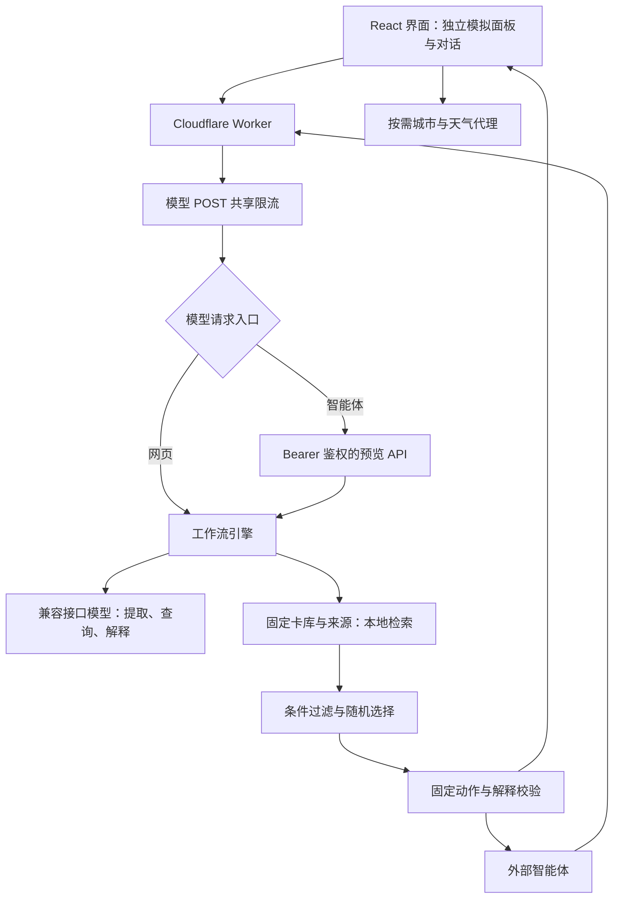

# 实现架构

浏览器负责交互与本地条件，Worker 保存服务器配置并编排模型、内容检索和规则。卡片步骤取自固定内容库，模型只参与理解与解释。

模型请求先经过 Worker 共享限流，再由智能体 API 校验 Bearer 密钥；非法请求也可能消耗一次入口限流计数。静态资源和公开发现文档不调用模型。

## 浏览器状态

模拟面板和对话拥有独立的快照、提醒状态、当前结果与历史。对话默认读取当前北京时间，手动指定时间后保留该时间；“餐后”只是情境，不用于猜时钟。模型提出字段后，用户确认才采用；旧运行结果不能覆盖新情境，查看历史也不会替换当前快照。

家／公司条件预设存入当前浏览器 localStorage，定位只在用户点击后请求。精确坐标在浏览器用于地点匹配；天气查询和城市识别使用降精度坐标。页面会话中的提醒次数和历史不写入服务器数据库。

## 11 个节点

| 节点 | 处理方式 | 作用 |
| --- | --- | --- |
| N01 接收输入 | 程序 | 校验并规范化情境 |
| N02 提取对话 | 模型或规则回退 | 提出字段、依据、歧义与冲突；结构化面板／API 输入跳过 |
| N03 确认并冻结 | 程序 | 固定本次快照、运行 ID、时辰与内容版本 |
| N04 组织检索查询 | 模型或规则回退 | 根据确认字段组织查询，限制标签范围 |
| N05 内容检索 | 本地文本与标签评分 | 查询固定内容与来源；不采用向量数据库或网络搜索 |
| N06 条件过滤 | 程序 | 检查时段、夜间属性、执行条件、频次与最近卡 |
| N07 选择卡片 | 程序 | 普通候选随机抽取；节气及稍后使用固定目标 |
| N08 解释选择 | 模型或模板回退 | 只引用允许事实与实际来源，不重写动作 |
| N09 复核 | 程序 | 检查固定动作、来源和过时／重复运行 |
| N10 展示与记录 | 程序 | 按运行模式更新页面会话状态 |
| N11 展开轨迹 | 程序 | 展示实际执行结果与回退状态 |

对话在展示提案时解析，确认运行时 N02 也记录一次提取结果；后者不覆盖已确认快照。模型调用不是任意执行代码或选择后端地址，模型也不决定动作步骤、随机数或配额。

解释校验同时检查来源 ID、理由 ID、时辰与常见情境断言：安静休息意图不能推出物理环境安静，休息眼睛不能推出已经看屏，活动时长不能推出刚运动结束。校验失败使用保守模板，不额外请求模型“自证正确”。这些约束减少无依据描述，但不构成临床安全或疗效证明。

## 提醒与主动浏览

| 模式 | 次数与状态 |
| --- | --- |
| 普通 `auto` | 每个上海日期最多 6 次，通常相隔至少 2 小时；检查睡眠、忙碌、主动休息、暂停和勿扰 |
| 节气首见 | 当天首次确认清醒可展示；不占普通 6 次，不受普通间隔限制；仍检查提醒条件 |
| `preview`／`reroll` | 用户主动浏览，不占次数、不写节气首见或重置普通间隔；仍检查卡片条件及页面内最近 3 张 |
| `snooze` | 复核原卡与当前条件；普通重显计次，节气重显不占普通次数；豁免自身重复与普通间隔 |

睡眠状态区分清醒、睡眠和未知，并检查观察时间。夜间未知不主动提醒；白天未知只在已确认通常作息许可下提醒，状态仍是未知。真实页面点击不会直接唤醒虚拟人物。对话主生成及智能体接口均采用主动预览；它们不是后台提醒。

智能体 API 每次创建新空状态，只返回投影后的卡片、出处和轨迹摘要。它不持久保存状态，也没有跨请求最近 3 张保证。`providerMode` 据本次节点执行结果生成，模拟接口测试与真实模型联调须分别记录。

## 服务接口与边界

`server/http.mjs` 提供页面状态、卡库、解析、运行、天气及智能体 API。Worker 对 `/api/run`、`/api/parse`、`/api/agent/card` 的 POST 使用同一个演示限流键；缺绑定时返回 503，额度暂不可用时返回 429。Bearer 密钥只保护智能体接口，网页模型入口仍是公开交互入口。

所有模型配置只从服务器环境读取。卡库与工作流兼容 Node 和 Worker，`node:test` 可以直接验证。没有数据库、后台定时器或设备 SDK；部署后的生产访问和模型费用控制由维护者负责，详见 [部署说明](deployment.md) 与 [安全说明](../SECURITY.md)。
